# Picfort

[](https://github.com/ljarka/Picfort/actions/workflows/ci.yml)

Picfort is an Android client for a self-hosted [Immich](https://immich.app) photo server. It shows your Immich library and the photos on your phone in one timeline. It can also send a photo to a picture frame on your home network.

> **Status:** early, personal project.

## Screenshots

| Timeline | Album | Search | Details |
|---|---|---|---|
| 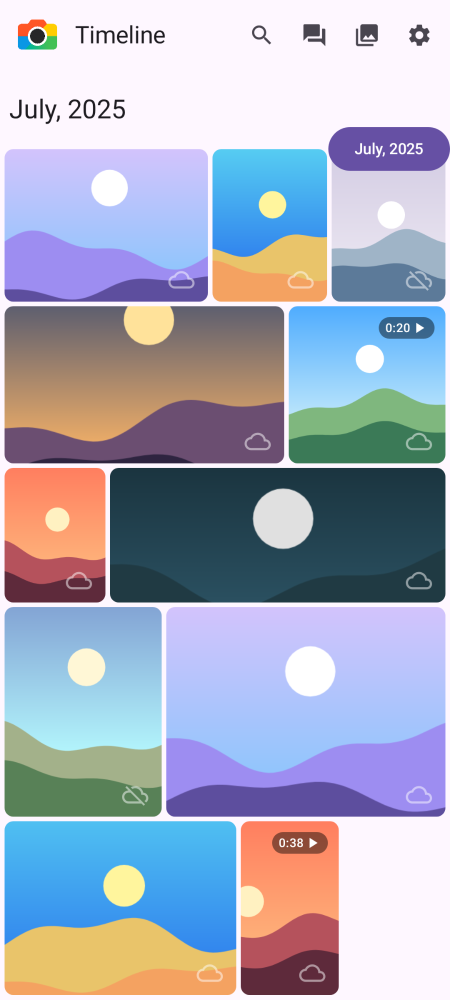 | 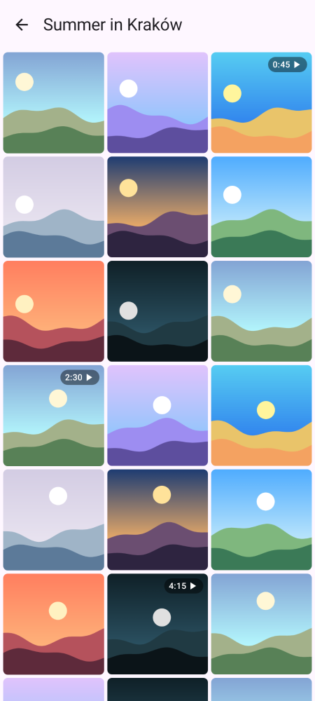 | 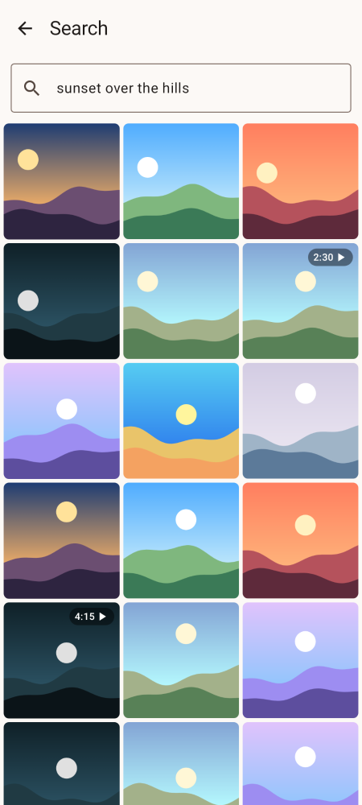 | 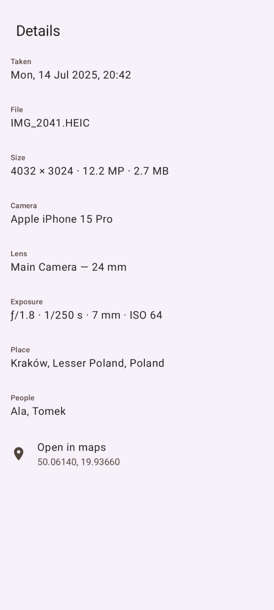 |

| Picture frame | Albums | Backup settings | Dark theme |
|---|---|---|---|
| 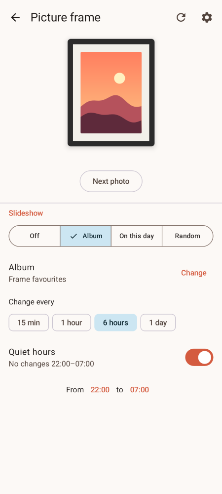 | 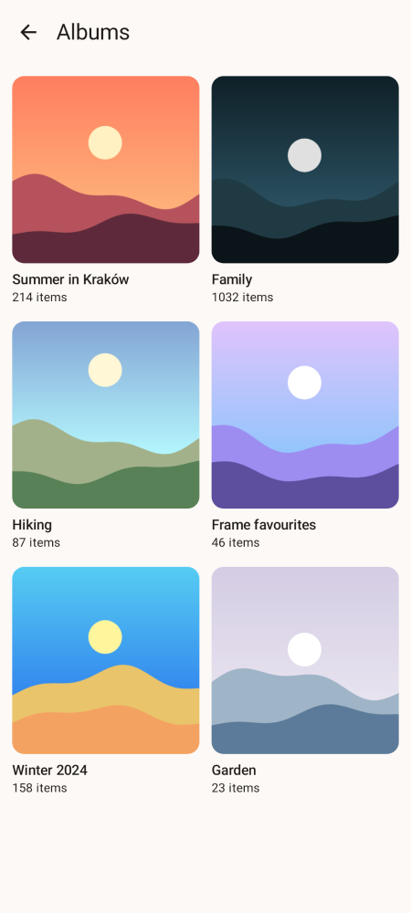 | 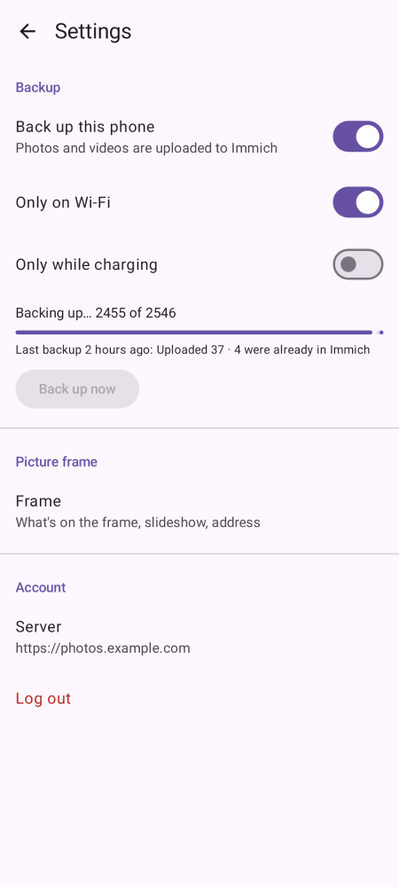 | 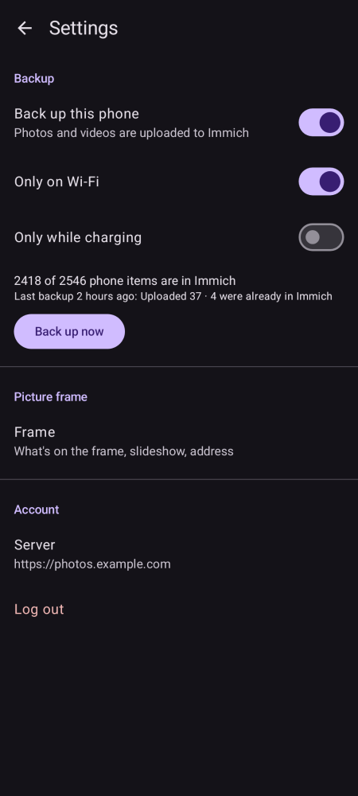 |

| Family Wall | Family Wall, one member | Picfort server | Family Wall, dark |
|---|---|---|---|
| 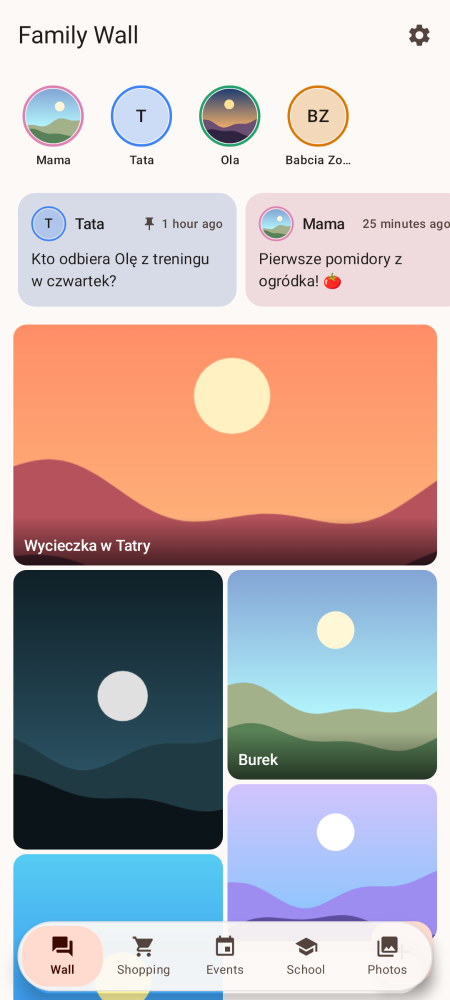 | 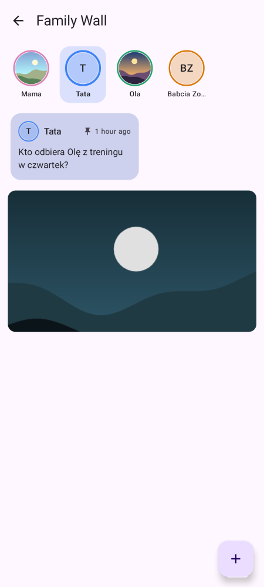 | 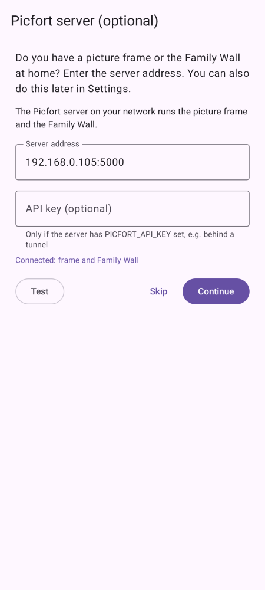 | 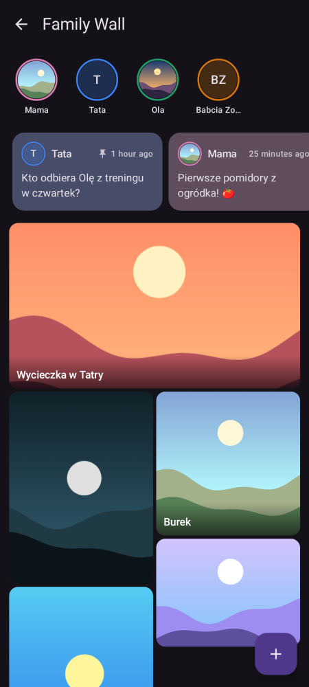 |

These are rendered from the app's UI code with sample photos by the [screenshot tests](#screenshot-tests). They are regenerated whenever the UI changes, so they always match the code.

## Features

- **One timeline.** Photos from Immich and from the phone's MediaStore (the last 24 months) are merged and grouped by month, newest first. A cloud icon shows where each image comes from.
- **Aspect-ratio grid.** A 4-column grid where wide photos take more columns. The number of rows per month is cached so the scrollbar is right before the images load.
- **Fast scroll.** A draggable scrollbar that shows the month you're scrolling to.
- **Offline-first cache.** Months and assets are stored in Room. Cached data is shown at once and refreshed in the background. Pull down to refresh.
- **Viewer.** A swipeable full-screen pager with pinch-to-zoom and a shared-element transition from the grid.
- **Backup.** Uploads the phone's photos and videos to Immich in the background (WorkManager). You can limit it to Wi-Fi or to while charging. Files Immich already has are detected by SHA-1 checksum and not uploaded again, and phone copies of backed-up photos are hidden so nothing shows twice.
- **Video.** Phone and Immich videos play in the viewer (Media3), with a duration badge in the grid.
- **Details.** Date, camera, lens, exposure, size, place, people and a map link for each item.
- **Selection actions.** Long-press to select items, then share, download to the phone, send to the frame, or delete. Deleted items go to Immich's or the phone's trash.
- **Albums.** Browse your Immich albums, and add selected items to an existing or new album.
- **Search.** Immich smart search ("dog on the beach"), with results that page in as you scroll.
- **Family Wall.** A shared board for the family: text posts as cards, photo posts in a grid, and a row of family members (the Immich users of your server) to filter by person. Write, pin and delete your own posts. Posts live on the Picfort server, so every phone and the frame see the same wall (ADR 0002, 0006).
- **Settings.** Backup, the Picfort server address, and your account.
- **Send to frame.** Puts the photo you're viewing on an e-paper picture frame (see below).

## Repository layout

```
app/                     Android app (Kotlin, Jetpack Compose)
  src/main/java/com/github/ljarka/picfort/
    db/                  Room database: month buckets and assets
    local/               MediaStore queries for photos on the phone
    network/             OkHttp/Retrofit setup and auth interceptor
    ui/init/             Startup routing: server setup, login, timeline
    ui/server/           Server URL screen and storage
    ui/login/            Login screen, token storage (encrypted)
    ui/timeline/         Timeline screen, repository, grid row layout, fast scroll
    ui/image/            Full-screen viewer, zoom
    ui/frame/            Frame settings, frame HTTP client (no Immich auth)
    ui/settings/         Settings screen (backup, frame, account)
    collections/         Albums, search, shared asset grid
    assets/              Share, download, delete, details (Immich API + MediaStore)
    backup/              Backup engine, worker, scheduler, upload API
    ui/preferences/      DataStore / encrypted preferences
ImageFrameServer/        Python service for the picture frame
  app.py                 Flask HTTP API (/run, /status, /slideshow, /next, …)
  slideshow.py           Slideshow modes, schedule, quiet hours
  immich.py              Immich API client used by the slideshow
  tests/                 unittest suite (no hardware or Immich needed)
  frame.py               Fetches from Immich, renders for the panel, drives the display
  wall.py, auth.py       Family Wall storage and Immich token check
  Dockerfile             Server image (ghcr.io/ljarka/picfort-server)
docker/                  docker-compose.yml and example.env for installing the server
```

## Architecture

```
Compose UI ──► ViewModel (Hilt) ──► TimelineRepository ──┬─► Room (month_buckets, assets)
                                                         ├─► Immich API (Retrofit)
                                                         └─► MediaStore (LocalImagesProvider)
```

- **Navigation:** `Init` → `Timeline` → `ImageDetails(assetId, assetType, imageIndex)`, using type-safe Navigation Compose routes.
- **Buckets:** monthly counts from `/api/timeline/buckets` are added to the local MediaStore counts. Each bucket stores a running global `index`, so the pager can turn a flat position into a month and an offset.
- **Assets:** loaded per month when needed (`/api/timeline/bucket` plus MediaStore), sorted by date taken and saved to Room. The ViewModel keeps at most 5 loads running and cancels the oldest.
- **Auth:** you log in with email and password and get an access token. The token is stored in encrypted preferences and added as `Authorization: Bearer …` to every request.

## Requirements

- Android Studio (recent stable), JDK 21+ (the Paparazzi plugin requires it)
- Android 8.0+ (minSdk 26, targetSdk 35)
- An Immich server you can reach from the phone

## Building and running

```bash
./gradlew assembleDebug          # build a debug APK
./gradlew installDebug           # install on a connected device or emulator
```

Or open the project in Android Studio and run the `app` configuration.

The first time you start the app:

1. Enter your Immich server URL, for example `https://photos.example.com`.
2. Log in with your Immich email and password.
3. Allow photo access so photos on the phone appear in the timeline.

## Tests

```bash
./gradlew testDebugUnitTest           # unit tests (also renders the screenshots)
./gradlew verifyPaparazziDebug        # fails if a screen no longer matches its screenshot
```

### Screenshot tests

`ScreenshotTest` and `TimelineScreenshotTest` (in `app/src/test`) render screens on the JVM with [Paparazzi](https://github.com/cashapp/paparazzi), with no device or emulator. Photos come from a small generator that draws deterministic landscapes, so the images are stable. The reference images are checked in under `app/src/test/snapshots/images/` and are also used in this README.

After an intended UI change, re-record the screenshots and commit the updated images:

```bash
./gradlew recordPaparazziDebug
```

## CI and releases

Every pull request and push to `main` runs [CI](.github/workflows/ci.yml):
- **Android:** unit tests, screenshot comparison, lint and a debug APK (downloadable from the run). When screenshots differ, the diffs are uploaded as an artifact.
- **Frame server:** the Python tests on 3.11 (Raspberry Pi OS Bookworm) and 3.13, and a build and smoke test of the Docker image.

Dependabot opens weekly update PRs for Gradle and pip, and monthly ones for GitHub Actions.

### Releasing

Push a version tag and the [release workflow](.github/workflows/release.yml) tests the app, builds a signed APK and publishes it as a GitHub release, together with `docker-compose.yml` and `example.env`. It also pushes the server image to `ghcr.io/ljarka/picfort-server` (tagged with the version and `latest`):

```bash
git tag v1.0.0 && git push origin v1.0.0
```

One-time setup: create a signing key and store it as repository secrets. **Keep the keystore and passwords safe**: updates must be signed with the same key.

```bash
keytool -genkeypair -keystore picfort-release.jks -alias picfort -keyalg RSA -keysize 4096 -validity 10000
gh secret set PICFORT_KEYSTORE_BASE64 < <(base64 -i picfort-release.jks)
gh secret set PICFORT_KEYSTORE_PASSWORD
gh secret set PICFORT_KEY_ALIAS --body picfort
gh secret set PICFORT_KEY_PASSWORD
```

Builds made before release signing used the debug key, so moving to a release APK means uninstalling the old app first (you'll log in again).

## ImageFrameServer

A small Flask service that puts Immich photos on a picture frame. It is meant to run on the device that drives the display, a Raspberry Pi with a Waveshare 13.3" e-Paper HAT+ (E). The frame downloads photos from Immich with its own API key, so controlling the frame never needs your login token. Only the Family Wall does: the app sends its Immich token on `/wall` calls, and the server asks Immich who you are (ADR 0006).

**Don't expose ImageFrameServer to the internet without an API key.** By default the frame endpoints have no authentication (ADR 0004): use it on your home network or over a VPN such as Tailscale. To reach it from outside through a tunnel, set `PICFORT_API_KEY` first (see [Reaching the server from outside](#reaching-the-server-from-outside), ADR 0007).

### Install with Docker (recommended)

Like Immich: two files ([`docker-compose.yml`](docker/docker-compose.yml) and the example [`.env`](docker/example.env), with every setting explained) and `docker compose up -d`. Run it on any always-on machine on your home network, for example the one that runs Immich.

```bash
mkdir picfort && cd picfort
wget -O docker-compose.yml https://github.com/ljarka/Picfort/releases/latest/download/docker-compose.yml
wget -O .env https://github.com/ljarka/Picfort/releases/latest/download/example.env
vim .env                          # fill in IMMICH_URL and IMMICH_API_KEY
docker compose up -d
```

Then in the app: **Settings → Picfort server**, enter `<this machine's IP>:5000` and tap **Test**.

- The Family Wall, its photos and the slideshow settings are stored in `./data` (`DATA_LOCATION` in `.env`). Back up that folder.
- Update: `docker compose pull && docker compose up -d`. Pin a version with `PICFORT_VERSION=v0.3.0` in `.env`.
- Logs: `docker compose logs -f`.
- The image is built for `amd64` and `arm64` (64-bit Raspberry Pi OS). Any variable from the table below can go in `.env`.
- On macOS, port 5000 is taken by AirPlay Receiver: set another `PICFORT_PORT` (e.g. `5050`) in `.env`.
- If Immich runs in Docker on the same machine, `IMMICH_URL=http://host.docker.internal:2283` works on Docker Desktop.
- In Docker the server runs in **preview mode** (no e-paper panel), which is all the Family Wall and the app need. To drive a Waveshare panel, install it directly on the Raspberry Pi (below).

### Immich API key

Create it in Immich under **Account settings → API keys**, logged in as the user whose photos the frame should show: the key only sees that user's photos and albums (their own and those shared with them). Give it only these permissions:

| Permission | Used for |
|---|---|
| `asset.read` | Picking photos for the slideshow (random, album, "On this day") |
| `asset.view` | Preview image, the fallback when the original can't be decoded (e.g. HEIC) |
| `asset.download` | Downloading the original photo for the frame |
| `album.read` | Listing albums for the slideshow settings |

The key is read-only. The Family Wall doesn't use it: it checks each user's own Immich login.

### Reaching the server from outside

With [Cloudflare Tunnel](https://developers.cloudflare.com/cloudflare-one/connections/connect-networks/) the server gets an `https://` address without opening a port on your router.

1. Generate a key and put it in `.env`, then restart (`docker compose up -d`):
   ```bash
   echo "PICFORT_API_KEY=$(openssl rand -hex 32)" >> .env
   ```
2. In Cloudflare Zero Trust → **Networks → Tunnels**, create a tunnel, run the `cloudflared` command it shows on the server machine, and add a public hostname (for example `picfort.example.com`) pointing to `http://localhost:5000` (your `PICFORT_PORT`).
3. In the app: **Settings → Picfort server**, enter `https://picfort.example.com` and the key, tap **Test**, then **Save**.

Every request needs the key; the Family Wall also still needs your Immich login. With a key set the server marks all responses `Cache-Control: private`, so Cloudflare doesn't keep wall photos at its edge.

### Install without Docker

```bash
cd ImageFrameServer
python3 -m venv .venv && . .venv/bin/activate
pip install -r requirements.txt
cp .env.example .env              # then fill in IMMICH_URL and IMMICH_API_KEY
set -a; . ./.env; set +a
python3 app.py                    # listens on 0.0.0.0:5000
```

Create the API key in Immich under **Account settings → API keys** (see [Immich API key](#immich-api-key) for its permissions).

Without `FRAME_DRIVER` the server runs in **preview mode**: every frame is dithered and saved to `last_frame.png`, which you can view at `/current`. That way you can try it on any computer.

### Raspberry Pi + Waveshare 13.3" e-Paper HAT+ (E)

The frame uses Waveshare's 13.3" E Ink Spectra 6 panel (1200×1600, 6 colours, about 19 s full refresh).

1. Enable SPI: `sudo raspi-config` → *Interface Options* → *SPI* → enable. Add these lines to `/boot/firmware/config.txt` (`/boot/config.txt` on older OS versions), then reboot:
   ```
   gpio=7=op,dl
   gpio=8=op,dl
   ```
2. Install the system packages: `sudo apt install python3-pil python3-numpy python3-spidev`.
3. Download Waveshare's driver. It isn't bundled here because it ships prebuilt `DEV_Config_*.so` files:
   ```bash
   wget "https://files.waveshare.com/wiki/13.3inch%20e-Paper%20HAT%2B/13.3inch_e-Paper_E.zip"
   unzip 13.3inch_e-Paper_E.zip -d ~/13.3inch_e-Paper_E
   ```
   You can check the wiring with Waveshare's demo: `cd ~/13.3inch_e-Paper_E/RaspberryPi/python/examples && python3 epd_13in3E_test.py`.
4. In `.env`, set:
   ```
   FRAME_DRIVER=epd13in3E
   FRAME_DRIVER_PATH=/home/pi/13.3inch_e-Paper_E/RaspberryPi/python/lib
   ```
   If you use a venv, create it with `--system-site-packages` so it can use `spidev`.

**Colour.** Photos are Floyd-Steinberg dithered against an approximation of how the six inks actually look, after a small saturation and contrast boost. The result is then mapped to the driver's pure colours, so the driver doesn't dither a second time. If colours look off, adjust `FRAME_SATURATION`, `FRAME_CONTRAST` or `FRAME_PALETTE`, and compare the panel with `/current`.

| Variable | Default | Meaning |
|---|---|---|
| `IMMICH_URL` | (required) | Immich base URL, e.g. `https://photos.example.com` |
| `IMMICH_API_KEY` | (required) | Immich API key |
| `FRAME_WIDTH` / `FRAME_HEIGHT` | `1200` / `1600` | Panel resolution in the driver's buffer orientation |
| `FRAME_ORIENTATION` | `auto` | `auto` rotates each photo to fill the panel. Use `portrait` or `landscape` for a frame mounted one way. |
| `FRAME_FIT` | `cover` | `cover` fills the panel and crops the edges evenly. `contain` shows the whole photo with padding. |
| `FRAME_BACKGROUND` | `white` | Padding colour |
| `FRAME_DRIVER` | (empty) | Driver module, `epd13in3E` for the 13.3" (E). Leave empty for preview mode. |
| `FRAME_DRIVER_PATH` | (empty) | Directory containing the driver (Waveshare's `RaspberryPi/python/lib`) |
| `FRAME_DITHER` | `spectra6` | `spectra6` dithers to the six inks; `none` sends full colour to the driver |
| `FRAME_PALETTE` | built-in | Six hex colours (black, white, yellow, red, blue, green) as they look on your panel |
| `FRAME_SATURATION` / `FRAME_CONTRAST` | `1.3` / `1.1` | Adjustments applied before dithering |
| `FRAME_MIN_INTERVAL` | `30` | Minimum number of seconds between refreshes (protects the e-paper panel) |
| `FRAME_STATE_PATH` | `slideshow.json` | Where slideshow settings are saved |
| `WALL_DB_PATH` | `wall.db` | Family Wall database (SQLite) |
| `WALL_PHOTOS_PATH` | `wall_photos` | Directory for photos attached to wall posts |
| `FRAME_PREVIEW_PATH` | `last_frame.png` | Where the last rendered frame is saved (shown at `/current`) |
| `PORT` | `5000` | HTTP port |
| `PICFORT_API_KEY` | (empty) | When set, every request needs `X-Picfort-Key: <key>` (enter it in the app next to the address). Required before exposing the server outside your network (ADR 0007). |

HEIC originals need `pip install pillow-heif`. Otherwise the server falls back to Immich's preview image.

### Slideshow

The frame can change photos on its own:

| Mode | Shows |
|---|---|
| `off` | Only what you send from the app |
| `album` | Random photos from one album, avoiding recent repeats |
| `memories` | "On this day": photos taken on today's date in earlier years (random photos when there are none) |
| `random` | Random photos from the whole library |

It changes every 15 min to 24 h and can pause during quiet hours (for example 22:00–07:00). A photo sent from the app stays up for a full interval. Set this up in the app under **Settings → Picture frame**, or through the API. The API key needs permission to read assets and albums and to search.

### API

| Endpoint | Response |
|---|---|
| `GET /status` | `{"status":"ok","busy":false,"currentAsset":…,"lastError":…,"slideshow":{…}}` |
| `GET /run?assetId=<id>` | `202` once the photo is fetched and rendered; the panel then refreshes in the background. Errors: `400` bad id, `404` asset not found, `409` still refreshing, `429` too soon (with `retry_after` and a `Retry-After` header), `502` Immich problem. |
| `GET /current` | PNG of the last rendered frame |
| `GET /slideshow` | `{"mode","album_id","interval_minutes","quiet_start","quiet_end","next_change_at",…}` |
| `PUT /slideshow` | Update any of those fields (JSON). `400` with a message if invalid. |
| `POST /next` | Show the next slideshow photo now (`409` if the slideshow is off) |
| `GET /albums` | `[{"id","name"}]`, for choosing a slideshow album |
| `GET /wall?limit=20` | Family Wall posts, pinned first, then newest first (`limit` 1–100) |
| `POST /wall` | New post by the caller, `multipart/form-data`: `text` and/or `photo` (JPEG, PNG or HEIC, max 10 MB). `201` with the post; `400` neither text nor photo, `413` photo too large, `415` not a supported image. |
| `DELETE /wall/<id>` | `204`; also deletes the photo. Own posts only (`403`), `404` if no such post. |
| `PUT /wall/<id>/pin` | Toggles `pinned` and returns the post. Own posts only (`403`). |
| `GET /wall/photo/<file>` | The photo attached to a post (`photo_url` in the post) |

A post looks like `{"id","author_id","author","text","photo_url","photo_width","photo_height","pinned","created"}`. `photo_width`/`photo_height` are the upright size, so the app can lay out photos before they load. The wall is stored in SQLite next to the server (ADR 0002). There are no migrations: if a new version changes the schema, the wall starts empty. Every `/wall` call needs `Authorization: Bearer <Immich access token>` (an API key doesn't work). The server checks it with `GET /api/users/me` on its own `IMMICH_URL` and remembers the answer for 5 minutes. No token or a rejected one gives `401`; if Immich can't be reached, `502`. The author of a post is the user of the token.

Run the tests with `cd ImageFrameServer && python3 -m unittest discover -s tests -t tests`.

You can also run it from the command line: `python3 frame.py <assetId>`.

### Using it from the app

The app calls ImageFrameServer the **Picfort server**: one address for the frame and the Family Wall. After the first login the app asks for it once (you can skip). Later, set it under **Settings → Picfort server**, with **⚙** in the photo viewer, or from the Family Wall. Enter the address (for example `192.168.0.105:5000`), and the API key if the server has `PICFORT_API_KEY` set, then tap **Test**: it says whether the frame and the Family Wall both work, or what's wrong (for example a server that uses another Immich). Then tap **Save**. After that, the **Send** button puts the photo you're viewing on the frame. Only photos on the Immich server can be sent, not photos that exist only on the phone.

## Security notes

- Plain `http://` is only allowed to local network and VPN addresses (private IPs, `.local`/`.lan`, Tailscale). Use `https://` for servers on the internet.
- HTTP logging is only on in debug builds, with credentials redacted.
- The access token is stored in encrypted preferences. If the server rejects it, the app returns to the login screen.

## Known limitations

- Photos that exist only on the phone can't be sent to the frame yet.
- Backup covers every photo and video on the phone; you can't pick albums yet.
- When Android doesn't allow backup to run in the foreground (it was started in the background on Android 12+), a run stops after about 10 minutes and the next run continues.
- Saving to the phone needs Android 10+, and deleting phone photos needs Android 11+.
- Months that were never opened while online show placeholders offline.

See the roadmap in the issues or project board.
